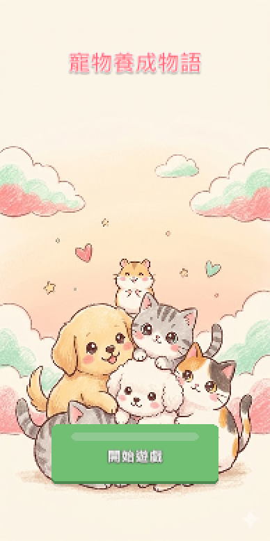
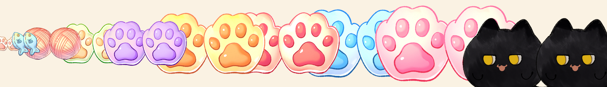

# 寵物養成物語｜合成＋Boss 戰的 roguelite 手機遊戲

把玩具丟進盒子裡，兩個一樣的玩具碰在一起就會合成更高一級的玩具，合成就是攻擊。連續打倒 6 隻 Boss，你的寵物就是最強的。

  

## 玩法

- 點擊或拖曳決定落點，放開投下玩具；相同的玩具碰在一起會合成下一級。
- 每次合成都會對 Boss 造成傷害，越高級的合成傷害越高。
- 玩具堆到超過頂線一段時間就輸了。
- 打倒一隻 Boss 後，從三個能力裡選一個帶到下一關（例如每投幾顆就變成炸彈）；盤面會跨關延續。
- 共 6 隻 Boss，每隻都有自己的干擾機制，後面的關卡會疊加前面的機制。

## 設計重點

- **合成就是攻擊**：把 Suika 類合成遊戲「消磨時間」的玩法，接上明確的勝負目標，讓每次合成都有回饋。
- **盤面跨關延續**：上一關留下的盤面就是下一關的開局，前一關的取捨會影響後面。
- **防死亡螺旋**：關間三選一能力用來補救盤面，避免一關失誤就整局無法挽回。
- **玩中學的新手引導**：第一戰用手勢提示與 Boss 出場短台詞當場示範，不放大段說明文字。

## 試玩與開啟專案

- **Android 試玩版**：[下載 APK](https://github.com/barryclown/WatermelonMerge/releases/download/v1.0/watermelonMerge.apk)（Releases v1.0，連結固定，會更新成最新 build）。
- **開專案**：Unity 2022.3.62f2（2D URP），唯一場景是 `Assets/Scenes/Merge.unity`。

## 專案結構

| 位置 | 內容 |
| --- | --- |
| `Assets/script/GameManager.cs` | 投放、拖曳、落點預測 |
| `Assets/script/Watermelon.cs` | 合成核心與炸彈 |
| `Assets/script/BossManager.cs`、`BossMechanic.cs` | 6 隻 Boss 的血量與干擾機制 |
| `Assets/script/AbilityManager.cs`、`DraftUI.cs` | 關間三選一能力 |
| `Assets/script/TutorialManager.cs` | 首戰引導 |
| `Assets/script/RuntimeUI.cs` | 以程式生成的介面（圓角、漸層、描邊、按鈕） |

## 限制

- 只測過 Android 與 Unity 編輯器。
- 介面只有繁體中文。
- 數值仍以實際試玩調整中。

## 素材與授權

- 字型：Noto Sans TC 子集，SIL Open Font License 1.1，見 [`licenses/`](licenses/)。
- 其餘程式與美術未另行授權，保留所有權利。
